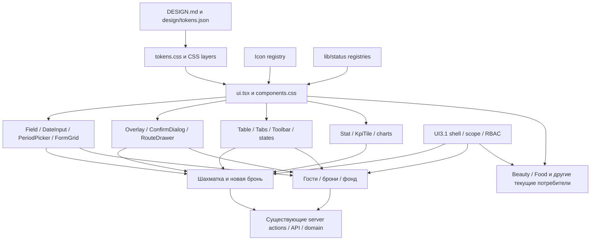

# UI3.2 и подготовка UI3.3

Статус: предложение на согласование, реализация не начата. Дата: 11.10.2026. Основание: последнее ТЗ владельца из вложения 55be606a. Этот документ описывает работу; нормативный источник визуальных правил остаётся DESIGN.md, значения токенов остаются в design/tokens.json. Новая дизайн-система не создаётся.

## 1. База и границы

Проверен clone `/Users/urijzapojnov/Developer/wetop-ui31-20261011`: ветка codex/ui3-1-hidden-navigation, HEAD e523f35fdc7d8d333d957e40571fd9a1417cf512. Tracked-файлы чистые; untracked до начала подготовки: материалы нашего аудита UI3.1 и четыре пары test entry/log. Locks пусты. Исходный WETOP содержит чужие изменения, не редактируется. Remote main read-only проверен: 2d3476cdd2ddd92a8d8d8d2719706f0c34f70f1b, уже отличается от main на момент предыдущего аудита. Содержимое нового main здесь не интегрировано; наличие UI3.1 в main/production не предполагается.

Для подготовки используется текущий clone e523f35. После согласования плана безопасный кандидат для локальной реализации: новая ветка codex/ui3-2-components от e523f35 в этом же выделенном clone, при повторно чистом tracked-состоянии и отсутствии чужих процессов. Ветка сейчас не создаётся. UI3.1 остаётся зависимостью, не объявляется принятой. Перенос на свежий main является отдельной задачей после review пересечений, особенно чужого board-date-range.tsx и гостевых экранов. Не копировать их автоматически и не переписывать чужие файлы.

Тесты только последовательно, fixture API или собственная PostgreSQL с отдельными портами/каталогами. Worktree не изолирует общую dev-БД. Никаких stash/reset/clean чужого дерева, удаления locks, merge/push/deploy. Новые PR ниже означают предлагаемые срезы, а не созданные GitHub PR.

Исторические tasks/plan.md и tasks/todo.md помечены исполненными и направляют текущую работу в plans/. Они сохранены; task list данного этапа в [todo.md](todo.md).

## 2. Состояние UI3.1 и доказательства

[Аудит](../../reports/ui3-1-audit-2026-10-11/audit.md) остаётся актуальным по неизменному runtime e523f35: свежий основной UI-набор 10/12, нестабильный /hotel-settings и гонка boundingBox теста филиала. Диагностика успешного пути не отменяет красный acceptance. Три unit-сбоя воспроизведены на родителе: два Bash UTF-8 и растущий архив журнала. Lint/typecheck и real API трёх вертикалей имеют прежние доказательства, не новый запуск этой подготовки.

Сейчас тесты повторно не запускались: код не меняется. До реализации зафиксировать решение по UI3.1-блокерам. Допускается подготовка компонентов, но нельзя объявлять готовым новый этап с красной общей приёмкой. Нормативные противоречия UI3.1 устраняются отдельным docs-срезом по [плану](../../reports/ui3-1-audit-2026-10-11/normative-plan.md).

## 3. Референсы

Проверены существование и SHA-256: [references.json](references.json). Доступны гостиничная шахматка, изображение трёх вертикалей и исходный снимок popover периода из вложений. Первые два сохранены в reports/ui3-1-audit-2026-10-11; снимок периода пока в исходном временном каталоге. Перед реализацией сохранить его в согласованном каталоге reference assets с provenance, без перерисовки.

Исторические снимки reports/guests-v2-2026-09-27, inventory-workspace-2026-09-30, reservations-* показывают предыдущую реализацию. Они не объявляются утверждёнными новыми макетами. Для гостей/броней, номерного фонда и новой брони нужны пути или вложения именно утверждённых макетов; это блокирует точную визуальную реализацию этих экранов, но не аудит зависимостей и UI3.2. Широкое меню на изображениях переопределено явным решением владельца: скрытая навигация.

## 4. Фактическая dependency map

[Полная опись прямых потребителей](consumers.md) включает 221 импортирующий ui.tsx файл .ts/.tsx (216 из них .tsx). Это количество модулей, не экземпляров компонентов. Overlay: 29 прямых .tsx-потребителей, DateInput: 19, PeriodPicker: 3, Tabs: 25. Косвенные зависимости useConfirm и CSS отдельно включаются в проверку PR.

Переиспользовать:

| Семейство | Существующий код | Важная граница |
|---|---|---|
| Кнопки/поля/панели/таблицы/статусы | components/ui.tsx, app/components.css | Не заменять библиотеку; HTML props и server/client совместимость сохранить |
| Иконки/статусы | components/icon.tsx, lib/status/* | Не добавлять второй registry; цвет не заменяет статус словами |
| Формы | Field, Input, Select, Textarea, DateInput, Switch, FormGrid | Checkbox уже native input в каталоге; новый wrapper только если есть реальный пробел |
| Даты | date-field.tsx, period-picker.tsx, property-time.ts | PeriodPicker сейчас два поля и ссылки, не range popover; не ломать его потребителей |
| Таблицы | Table density normal/compact, sticky header/column/both | Сортировка/фильтр/пагинация принадлежат экрану, не внедрять универсальные бизнес-правила |
| Карточки | Panel, Stat/Stats, KpiTile, section-cards.tsx | Разные составные карточки не сводить к одинаковым данным; унифицировать поверхность |
| Окна/панели | Overlay, ConfirmDialog, useConfirm, RouteDrawer | Вложенные окна, Escape и возврат фокуса, отмена без mutation |
| Графики | LineChart, DayBars, DonutShare, ShareBar | Существующие series/formatters, без пересчёта финансов |
| Состояния | EmptyState, LoadingState, Skeleton, Alert, Notice, LoadError | Сохранять retry, введённые значения и различие empty/error |

CSS layers уже существуют: reset < tokens < base < components < sections < utilities. components.css владеет общими примитивами, premium.css/workspace.css и CSS разделов перекрывают их. Поэтому изменение общего правила проверяется и на потребителях с overrides. Устаревший комментарий ui.tsx про globals.css исправить при соответствующем PR.

## 5. Предлагаемый контракт для включения в DESIGN.md

Это консолидация существующих значений, не разрешение менять их в коде до согласования. Новые визуальные значения не выбираются по вкусу. Утверждённые макеты определяют композицию, существующие токены определяют цвета/шрифт/размеры.

| Область | Контракт и AS-IS |
|---|---|
| Шрифт | Текущий системный стек; закрытая шкала 13/14/15/17/19/22/26/30; существующие веса и tabular-nums для чисел |
| Отступы | Шкала 4/8/16/24/32/40/48/64 через токены; legacy 12/14 и другие исключения сначала описать и проверить, без массовой замены |
| Кнопки | Текущие --control-h 38, sm 30, xs 24; touch target минимум 44; radius-control 10, Icon 20/16; поддержать текущие tones без переименования |
| Состояния кнопки | Normal/hover/active/focus-visible/disabled/loading; текущая loading-конвенция disabled + aria-busy + текст; без нового спиннера/политики submit по умолчанию |
| Поля | Высота минимум38 desktop, target44 mobile; единые border-input/surface/text; Field связывает label, hint/error и aria-invalid; native type/name/validation сохранить |
| Карточки | Panel padding24 desktop/16 mobile, radius16, border1, без новой тени; согласовать legacy gap14 со шкалой отдельной проверкой. KPI и объектные карточки используют ту же поверхность, разный состав |
| Таблицы | Сохранить normal/compact: AS-IS header42/32, cell padding8x16/4x8. Не задавать фиксированную высоту tbody, которая обрезает многострочные данные. Согласовать эти числа явно как существующий контракт в DESIGN |
| Окна | Существующие sm/md/lg 400/560/760; drawer400/480/760; окно radius20; viewport clamp на мобильных; UI3.1-menu radius10 является отдельным исключением |
| Графики | Только текущие semantic/chart tokens, подписи/легенда/доступная таблица; empty/loading/error обязательны, финансовые series неизменны |
| Шапка | UI3.1 56+safe-area, скрытое меню, scope/RBAC/active route без изменений; global header-h100 не менять без карты потребителей |

Не создавать отдельные универсальные компоненты BookingCard/EmployeeCard только ради названий: сначала составить их из имеющихся Panel/Stat/StatusBadge. Не переносить глобально статус гостиницы на запись Beauty или стол Food.

Нормативный PR: изменить существующие разделы DESIGN.md, а не добавлять конкурирующий хвост; в CLAUDE.md и apps/web/CLAUDE.md дать ссылки на них. В DECISIONS.md записать только согласованные решения и последствия. AGENTS.md сохраняет правила работы; визуальные числа не дублировать. design/tokens.json и generated tokens.css не входят в стартовый PR, пока аудит не докажет необходимость изменения токена.

## 6. Последовательность

Сначала docs-согласование и UI3.1 acceptance, затем **UI3.2-A: кнопки и иконки-кнопки**. Это первый видимый проверяемый срез через существующий /design-system и репрезентативных потребителей. Он не переписывает 216 экранов.

Далее поля, окна/панели, карточки, таблицы; даты выделены отдельно из-за сценария включительного диапазона. Графики независимы от пилота шахматки. Детальные маленькие срезы, файлы, критерии и проверки: [todo.md](todo.md).

После необходимых UI3.2-срезов и отдельного утверждения [UI3.3](ui3-3.md) первым пилотом становится шахматка. Гости/брони/фонд/новая бронь следуют последовательно. UI3.4–UI3.8 и специализированные Beauty/Food не реализуются здесь.

## 7. Матрица проверок

Для каждого изменённого экрана: 1440/1536/768/390/320, light/dark; нормальные, пустые, большие данные, длинные имена, loading, error. Синтетические fixtures. Screenshot before/after на одинаковых данных, датах и viewport, ссылки на конкретный reference. Не менять baseline автоматически. Дополнительно 200% zoom, клавиатура, axe, target44 на телефоне, внутренний скролл таблиц вместо страницы, читаемый статус без reliance on color.

Для общих примитивов: /design-system + все известные consumers через статический/typecheck аудит; браузерная матрица репрезентативных потребителей каждого варианта/override; перед объединением срезов полный действующий UI-набор. В regression включить Hospitality, Beauty, Food, финансы и настройки, даже если их композиция не менялась. Проверять не только screenshot, но клики, submit один раз, запрет действий по роли, сохранение input после error, nested Escape и историю drawer.

Запуски по TESTING.md: npm run test:status, затем npm run test:record -- lint/typecheck/unit по отдельности; браузер через npm run test:record -- e2e --config tests/ui/playwright.config.ts с согласованными файлами. Для mutation booking/inventory дополнительно настоящий локальный API/DB, не считать fixture доказательством persistence. Точные тесты перечислены в todo/ui3-3. Изменение поведения: RED до правки и GREEN после, без удаления assertions или повышения timeout ради зелёного.

## 8. Риски

| Риск | Уровень | Мера и gate |
|---|---|---|
| Shared CSS затронет сотни файлов | Высокий | Consumer inventory, один selector family за срез, CSS override audit, регрессии трёх вертикалей |
| Красный UI3.1 принят за стабильную базу | Высокий | /hotel-settings и тест филиала остаются открытыми; baseline unit отдельно, общий gate не маскировать |
| Чужие изменения и движение main | Высокий | Только изолированный clone; новая проверка пересечений перед переносом |
| Off-by-one периода / ночей | Высокий | Диапазон колонок включительный, departure проживания исключительная; независимые проверки |
| Drawer/URL ломает guest history | Высокий | Сохранить оба маршрута, deep links, refresh/back, существующие actions |
| Замена финансовых данных ради макета | Высокий | Только view, прежние API/formatters, сверка результата mutation |
| Недостающий утверждённый макет | Средний | Запросить файл до визуальной реализации конкретного экрана |
| Устаревшие baseline/отчёты | Средний | Evidence с SHA, не переносить старое PASS на новый код |
| Удаление работы через collapse/filter | Высокий | Сохранять выбранную бронь/черновик, проверки отмены и восстановления |

## 9. Решение для согласования

Согласовать этот план и первым разрешить только UI3.2-A после нормативного среза и решения по приёмке UI3.1. Следующий checkpoint после кнопок: diff, скриншоты и тесты до перехода к следующему семейству. Макеты отсутствующих экранов можно предоставить позже, до соответствующего UI3.3-среза. Текущее действие заканчивается подготовкой; runtime и нормативные файлы сейчас не изменяются.
