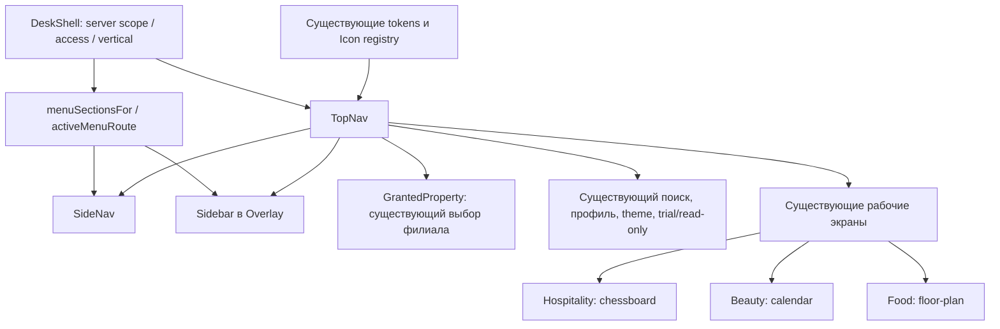

# WETOP UI3.1: общая оболочка

Изолированная ветка `codex/ui3-1-hidden-navigation` в `/Users/urijzapojnov/Developer/wetop-ui31-20261011`, база `b811e67f8ab0e77b39b4f3aa4e2e7945fd70ffdd`. Исходный checkout и общая Supabase не менялись.

## Что изменено

- Одна кнопка меню, скрытая desktop-панель с подразделами по наведению/фокусу.
- Отдельное мобильное окно с удержанием фокуса, без постоянной нижней навигации.
- Шапка 56 px, цели нажатия 44 px, существующие токены и Lucide.
- Закрытие при переходе, смене филиала, Back/Forward и смене размера экрана; возврат фокуса после Escape и перехода.
- Активная группа мобильного меню определяется по текущему виду бизнеса.

## Текущая карта зависимостей

Runtime изменён в пяти файлах: `components/top-nav.tsx`, `components/shell/side-nav.tsx`, `components/shell/side-nav.css`, `components/shell/sidebar.tsx`, `app/workspace.css`. API, domain, schema, зависимости и глобальные токены не изменены.

## Проверки и ограничения

Подробный результат, критерии и разбор неуспешных попыток: [протокол реализации](implementation.md). Все прогоны: [журнал](runs.md).

Три вертикали и переключение филиалов: **4/4 passed** через реальный локальный API. Обучение: **7/7 passed**, профиль: **3/3 passed**, мобильная форма брони: **passed**. Lint и typecheck прошли.

В широком UI-прогоне остаётся нестабильный переход на /hotel-settings: ожидание ответа dev-сервера превышает 15 s; более ранний неизменённый повтор прошёл. Общий браузерный набор не объявляется полностью зелёным.

Полный unit: 4521 passed, 3 failed, 4 skipped. Все три сбоя воспроизведены без UI3.1 на исходной базе: [сравнение](baseline/README.md). Общий gate не объявляется зелёным.

## Визуальные доказательства

[Desktop, закрытое меню](after-desktop.png) · [Mobile](after-mobile.png) · [Desktop, открытое меню](regression/panel-light-1440.png). В `verticals/` находятся 24 снимка трёх видов бизнеса: desktop/mobile, light/dark, меню открыто/закрыто.

Эти снимки показывают только новую оболочку вокруг существующих календарей. Единый контрол периода, новая шахматка, календарь мастеров и редактор залов/столов относятся к следующим этапам. UI3.2–UI3.10 не начаты. Merge, push и production deploy не выполнялись.

Утверждённая историческая спецификация, матрица рисков и критерии: [UI3.0/UI3.1](ui3-0-ui3-1-spec.md); уточнение свежей базы: [preflight](preflight.md).
