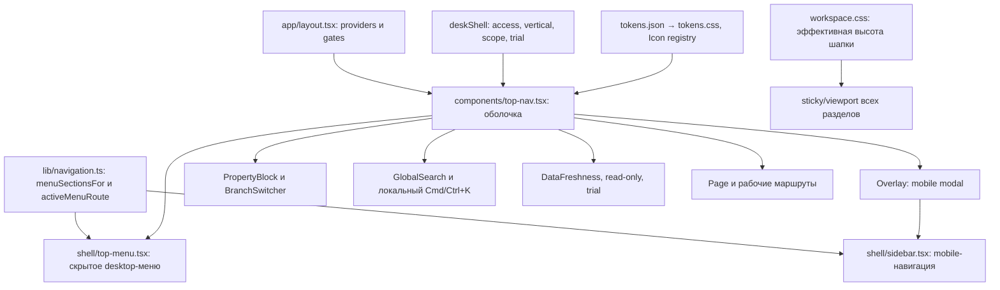

> Историческая основа планирования на базе 955b43f70. После команды владельца начат только UI3.1 в отдельной копии актуального main. Текущие файлы, доказательства и ограничения: [протокол реализации](implementation.md).

# UI3.0 и UI3.1: спецификация к реализации

Дата: 11.10.2026. Основание: принятая владельцем дорожная карта UI3 и шесть обязательных уточнений в текущем чате.
Статус: подготовка завершена; код не изменён. Реализация, создание окружения и прогоны не выполнялись.
Этот документ заменяет прежние положения plan.md о постоянной левой панели и выборе композиции между двумя изображениями.

Обязательное дополнение владельца: [Три специализированных календаря](unified-calendars.md). Для UI3.1 оно расширяет проверку оболочки на `/chessboard`, `/calendar`, `/floor-plan`, но не разрешает реализацию всех специализированных экранов.

## 1. Границы

UI3.0: проверка базы и изоляции, уточнение маршрутов, исходные снимки, карта зависимостей, проверяемый UI-контракт.
UI3.1: только общая оболочка и скрытая навигация. Пилотный маршрут для проверки оболочки: `/chessboard`; контрольные страницы: `/guests`, `/reservations`, `/hotel-settings`, `/finance`, `/bar`, `/marketing`, `/platform/support`, доступные страницы Beauty и Food.

В этом поручении выполняются только документы. UI3.2–UI3.10 не начинаются. Примитивы форм, карточек и таблиц фиксируются как неизменяемая база; их массовая унификация не входит в UI3.1. Контрол периода и содержимое шахматки относятся к UI3.3, ниже зафиксированы их требования без реализации.

Не меняются модель данных, финансовые и booking-правила, API, права, набор разделов, тарифы, интеграции, подписки и trial/read-only. Нет merge, push или production deploy.

## 2. UI3.0: актуальная база и безопасная работа

### Подтверждено сейчас

- Cwd: `/Users/urijzapojnov/Documents/ChatGPT/WETOP`.
- Ветка: `recovery/owner-design-v2-20261010`, HEAD `955b43f70`.
- Изменены DECISIONS.md и QUESTIONS.md. Есть чужие неотслеживаемые файлы в apps/web и apps/site, включая шахматку, гостей и today. Это не материал для автоматического переноса в новую работу.
- `tests/runs/.locks/` пуст, но отсутствие активных сессий и прогонов этим не доказано.
- Удалённая вершина main не проверялась; текущий HEAD не объявляется актуальным main.
- Реестр audit.md содержит 110 файлов page.tsx вместе с сайтом и intercept/slot, а не 110 доказанно независимых URL. Runtime-проверка редиректов, доступа и маршрутов ещё не выполнена.

### Рекомендуемый способ после разрешения на реализацию

1. Создать отдельный чистый clone в новой соседней папке, например `WETOP-ui31-20261011`, не внутри текущего дерева. При существующей папке выбрать новый путь, ничего не очищать. Источник: проверенный origin текущего репозитория, без печати URL с возможными credentials.
2. В новом clone получить origin/main, зафиксировать полный SHA, дату и состояние проверок. Создать `codex/ui3-1-hidden-navigation` от этого SHA. Не использовать recovery-ветку как актуальную базу по умолчанию. Если в main отсутствуют нужные восстановительные изменения, перечислить расхождения и остановить зависимую работу до их штатной передачи; не cherry-pick и не копировать чужие файлы.
3. Повторно прочитать AGENTS.md/CLAUDE.md/apps/web/AGENTS.md на выбранной базе, сверить инструкции и список файлов этого плана. Текущее дерево не переключать, не stash/reset, не индексировать. Отдельный clone изолирует также Git index и служебные refs.
4. В новом clone использовать собственные node_modules и `.next-ui`, отдельные пути отчётов. Не связывать их с папками чужого прогона. Не копировать .env, реальные данные или секреты.
5. Для UI3.1 использовать существующий `tests/ui/playwright.alt.config.ts`: настоящий Next.js + синтетический loopback API, без Supabase. Порты задаются `UI_WEB_PORT`/`UI_FIXTURE_PORT`; 3108/4318 только кандидаты, перед запуском проверить, что они свободны. При занятом порте выбрать другой, не завершать процесс владельца. Конфиг передаёт `FIXTURE_PORT` и `UI_FIXTURE_API`; это нужно для попадания reset-запросов в свою фикстуру.
6. `reuseExistingServer: false`, один worker, запуск через test:record. Не запускать одновременно две Next-сборки в одном clone. Стенд alt не запускает публичный сайт; соответствующие наборы не включать в UI3.1 без отдельного изолированного стенда.
7. Если потребуется доказательство на реальном API, выделить отдельную локальную PostgreSQL с уникальными `PMS_LOCAL_PGDATA`, `PMS_LOCAL_PGPORT`, своим API и синтетическим seed. Умолчания `/tmp/pms-local-db` и порт 55432 не использовать без проверки владельца. До доказательства изоляции не выполнять reset/migration. UI-фикстура сама по себе не является доказательством tenant isolation или работы PostgreSQL.
8. До прогона проверить locks и test:status в своей копии; изначальную сессию и её ресурсы не трогать. При неясной принадлежности процесса/базы ждать. Ни отдельная ветка, ни worktree сами по себе не решают проблему общей базы.

Это предложение, clone и окружение сейчас не создавались. Альтернатива: дождаться, пока владелец текущих изменений завершит работу и передаст чистую базу. Работать поверх нынешнего грязного дерева не предлагается.

### Результаты UI3.0 перед кодом

Полный SHA базы; подтверждённое чистое новое дерево; карта собственных портов/процессов/папок; подтверждение отсутствия внешних API и общей БД в UI-стенде; снимки исходной оболочки; сравнение реестра маршрутов с navigation.ts; список редиректов и intercept-маршрутов; замеры computed styles; перечень отличий базы от этого плана. Не присваивать OK по одному чтению исходников.

## 3. UI3.1: скрытая навигация

### Desktop, ширина больше 960 px

Одна кнопка «Открыть меню» в первой строке шапки, слева от бренда. Постоянной левой панели, полосы иконок и второй строки вкладок нет. Закрытое меню не резервирует ширину или высоту. Открытая поверхность располагается под кнопкой поверх контента, без сдвига страницы.

Кнопка кликом, Enter или Space открывает все основные разделы, отфильтрованные существующим `menuSectionsFor`. Второй клик закрывает. При открытии фокус переходит на текущий доступный раздел, если его нет, на первый. Основные разделы показываются в существующем порядке и с действующими названиями. Для `direct`-раздела остаётся ссылка; группа раскрывает подразделы на hover или focus, также по клику для touch-ноутбуков.

В каждый момент раскрыта одна группа. Подразделы располагаются во второй колонке той же поверхности: курсор переходит в них без разрыва области наведения. Уход мыши за границу сам по себе не закрывает всё меню; закрытие по кнопке, внешнему клику, Escape, уходу клавиатурного фокуса из всей поверхности, выбору маршрута или смене филиала. Открытие поиска/профиля закрывает навигацию.

Tab/Shift+Tab обходят видимые кнопки и ссылки естественно, ArrowRight на группе переводит фокус в первый подраздел, ArrowLeft возвращает на группу, Escape закрывает поверхность и возвращает фокус на кнопку. Скрытые подразделы не фокусируются. Использовать `nav`, кнопки с `aria-expanded`/`aria-controls` и обычные ссылки; не объявлять `role=menu`, не реализовав весь соответствующий клавиатурный паттерн.

Только текущая конечная ссылка получает `aria-current=page`; родительская группа отмечается визуально. Источник определения: `activeMenuRoute`, включая вложенные страницы, а не сравнение по произвольному startsWith. После выбора, включая текущий маршрут, меню закрывается. Browser back/forward и смена pathname также сбрасывают открытое состояние. После завершённого перехода фокус переносится на `#main-content`; Escape возвращает его к триггеру. Не красть фокус при фоновом обновлении данных.

### Mobile/tablet, ширина 960 px и меньше

Та же единственная кнопка открывает отдельную модальную поверхность «Навигация» через существующий Overlay и Sidebar. Группы раскрываются по нажатию или клавиатуре, одна за раз. Горизонтального flyout нет. Overlay удерживает фокус, блокирует фоновую прокрутку, поддерживает Escape/закрытие, возвращает фокус на кнопку. Переход закрывает поверхность.

Постоянная нижняя панель быстрых разделов убирается в рамках утверждённой модели «меню под одной кнопкой»; её маршруты остаются в полном меню. Удаляется только связанный с этой панелью резерв высоты, safe-area сохраняется. Поиск, тема и профиль остаются доступны в шапке; выбор филиала переносится в начало мобильного меню, как в действующем компоненте.

### Состояния и данные

Существующие access/vertical/scope-функции используются без изменения политики. Пока доступ неизвестен, применяется текущий CLOSED_ACCESS/существующая политика загрузки, без показа закрытых ссылок. При ошибке загрузки оболочки доступ не расширяется; корректное пустое состояние и повторная загрузка через имеющийся механизм. Полное меню остаётся доступным в read-only; запрещённые операции по-прежнему ограничиваются существующими guards.

Trial и DataFreshness из удаляемой второй строки переезжают в подвал меню, без нового опроса и без потери read-only-banner на странице. Существующий DataFreshnessProvider сохраняется. Scope-switch закрывает все открытые поверхности и не даёт действовать со старым филиалом. Глобальный поиск и приоритет локального поиска по Cmd/Ctrl+K сохраняются. Колокольчик из рисунка не добавляется без действующего механизма уведомлений.

## 4. Точный UI-контракт

Значения ниже зафиксированы по tokens.css, tokens.json и владельцам CSS текущей базы. Это целевой контракт UI3.1, а не утверждение о текущих computed styles. В новой базе значения сверяются до реализации. Новая палитра, гарнитура, CSS/UI-библиотека не нужны.

| Объект | Контракт | Применение |
|---|---|---|
| Шапка | Одна строка 56 px, `--header-row-h`; safe-area сверху добавляется отдельно | UI3.1, desktop и mobile |
| Высота для sticky/viewport | Внутри `.workspace` эффективный `--header-h` равен 56 px плюс верхний safe-area; единое значение для потомков | UI3.1; убрать старый mobile override 60 px, проверить всех потребителей |
| Глобальные tokens.json/tokens.css | Не менять; нынешний глобальный `--header-h=100px` не переписывать вручную в generated CSS | Локальный alias существующих переменных у владельца оболочки, документируется в DESIGN.md |
| Шапка: боковые отступы | 24 px desktop, 16 px mobile; промежутки групп 16 px, внутри группы 8 px | `--space-6/4/2` |
| Кнопка меню/темы/поиска без текста | Минимум 44×44 px, иконка 20 px, radius 10 px | `--touch-target`, `--icon-size`, `--radius-control` |
| Меню desktop | Ширина 560 px из `--overlay-w-md`, две равные колонки; внутренние отступы 8 px, gap 8 px; отступ от триггера 8 px | Высота auto, максимум viewport минус шапка и 16 px; внутренняя прокрутка |
| Положение меню | От края viewport минимум 8 px, при недостатке места смещение внутрь viewport; z-index `--layer-sidebar=40` | Поверх sticky=5/header=30, ниже Overlay=50 |
| Строка меню | min-height 44 px, padding 8 px, gap 8 px; текст 14 px/1.4, иконка 20 px | Длинные подписи переносятся, строка растёт; 44 px минимум, не обрезающая фиксированная высота |
| Мобильная поверхность | Ширина min(400 px, viewport минус 16 px), `--drawer-w-sm`; max-height viewport минус safe-area и 16 px; padding 16 px | Одна колонка, внутренний scroll, цели 44 px |
| Поверхность меню | `--surface-solid`, рамка 1 px `--border`, radius 10 px, `--shadow-floating` | Hover `--row-hover`, active `--primary-soft`/`--primary`, текст `--text`/`--text-2` |
| Движение/фокус | `--duration-fast=120ms`, `--easing-out`; reduced-motion без анимации; outline 2 px, offset 2 px | Открытие не ждёт окончания анимации; контраст из действующей темы |
| Контент | Никакого left offset/колонки для закрытого меню. Существующие Page width full/narrow/medium сохраняются | Шахматка full; обычные страницы max 1680, narrow 1080, medium 1320 px, без унификации ширины всех сценариев |
| Отступы страницы | Desktop: текущие 16 px сверху, 32 px по бокам, 24 px снизу; full: 16/24/24. Mobile: 16 px по сторонам, прежний верхний отступ 22 px, низ 24 px + safe-area вместо резерва нижней панели | Только удаление освобождённого резерва входит в UI3.1; ритм остальных страниц не переписывается |
| Заголовок страницы | Действующий Page: 30 px/1.2/700; мобильный размер 26 px (`--text-3xl`) по существующему breakpoint компонента; head gap 16 px, margin-bottom 24 px | В UI3.1 не вводить другой Page и не менять типографику страниц |
| Обычные кнопки | 38 px высота, горизонтальный padding 16 px, gap 8 px, текст 15 px, radius 10 px; на touch min target 44 px | Button как есть, без глобальной смены размеров |
| Поля | Input/Select: min-height 38 px, padding 8×12 px, текст 15 px, radius 10 px; touch-правила существующего компонента сохраняются | Значение 12 px уже есть в примитиве; не размножать локальные версии и не исправлять его в UI3.1 |
| Панели | Panel: padding 24 px, внутренний gap 14 px, radius 16 px, рамка 1 px, без тени/blur | Зафиксировано текущее исключение 14 px; исправление ритма только в UI3.2 |
| KPI | Stat: padding 16 px, radius 16 px, рамка 1 px, без фиксированной большой высоты | Не менять карточки страниц в UI3.1 |
| Таблицы | th height 42 px, padding 8×16 px; td padding 8×16 px; текст td 14 px, th 13 px | Существующий Table; высота строк зависит от контента, не фиксировать все строки |
| Шрифт и иконки | Существующий системный `--font/--font-head`, шкала 13/14/15/17/19/22/26/30; Lucide через Icon registry | Не загружать webfont, не использовать emoji вместо значков |

Ширины и размеры оболочки фиксируются здесь как точная спецификация, глобальная геометрия примитивов заморожена. Для шапки при 200% zoom допустим переход в мобильную компоновку, не увеличение её строк ради всех desktop-подписей. Длинные названия объекта сокращаются визуально с доступным полным названием; полные подписи есть в переключателе.

## 5. Зафиксированный контракт шахматки и дат, только для будущего UI3.3

Последний утверждённый макет является визуальным ориентиром с приоритетом текстовых уточнений владельца: скрытая навигация, максимум площади сетки, одна компактная панель управления, основное действие «Новая бронь», поиск/фильтры, закреплённая колонка номеров и коек, раскрываемые категории, корректные реальные статусы. Не добавлять отсутствующие действия, KPI или источники данных. Сохранять создание/просмотр/перемещение и остальные фактически доступные сценарии и ограничения ролей.

Один контрол периода. Рядом отдельная «Сегодня» и стрелки назад/вперёд. В popover слева ровно шесть пресетов: Сегодня, 7 дней, 14 дней, 30 дней, Текущий месяц, Произвольный период. Справа календарь выбора дат. Снизу фактический диапазон, число колонок и «Применить». «Следующий месяц» как дополнительный пресет не добавлять. На мобильном те же функции в одной колонке без выхода за экран.

Открытие копирует применённый диапазон в черновик. Выбор дат/пресета меняет черновик; «Применить» валидирует и обновляет диапазон через действующие query-параметры. Escape/внешний клик отменяет черновик. Повторное открытие показывает применённое значение. Другие фильтры сохраняются. Кнопка «Сегодня» и стрелки сохраняют действующую семантику навигации; перед UI3.3 сверить её с week-period/month-period/range-plan и существующими тестами, не придумывать поведение при конфликте.

Диапазон календаря включительный: N колонок = календарная разница дат + 1. 10–24 октября: 15 колонок. Пресет 14 дней: today…today+13, «Сегодня»: одна колонка, «Текущий месяц»: первый…последний день месяца по поясу объекта. Это не меняет эксклюзивность departure в модели проживания. Учитываются MAX_CHESSBOARD_DAYS, границы месяца/года, високосный февраль и пояс объекта. Никакой новой UTC-конвертации stay dates.

UI3.1 не меняет PeriodPicker, DateInput, BoardMenu, page.tsx или CSS шахматки. Шахматка используется только для проверки влияния оболочки.

## 6. Dependency map

Контракт данных однонаправленный: меню читает существующий DeskShell/registry, не определяет права самостоятельно. Desktop и mobile имеют разные поверхности, но общий источник разделов. Overlay переиспользуется без изменения API.

Потребители `--header-h`, найденные по исходникам: chessboard/board.css, reservations/reservations.css, guests/guests-bookings.css, finance/finance.css, bar/bar.css, marketing/marketing.css, platform/support/support.css, components.css и workspace.css. В globals.css есть глобальный scroll-margin-top; переменная, заданная на workspace, наследуется его потомками. today/dashboard.css также содержит зависимость, но файл чужой и неотслеживаемый, его только учитывать при передаче базы. Точная карта повторяется на актуальном clone.

## 7. План изменений файлов UI3.1

Все пути относительно репозитория. Это allowlist будущего изменения; сейчас отредактированы только свои документы в reports/.

| Файл | План | Ограничение |
|---|---|---|
| apps/web/src/components/top-nav.tsx | Одна кнопка меню на всех размерах; выбор desktop/mobile поверхности; закрытие на route/scope; удалить вторую строку и нижнюю панель; сохранить providers, поиск и guards | Не менять серверные вызовы и роль пользователя |
| apps/web/src/components/shell/top-menu.tsx | Переиспользовать как скрытое desktop-меню, состояние группы, hover/focus, keyboard, trial/freshness | Не создавать второй список маршрутов |
| apps/web/src/components/shell/top-menu.css | Двухколоночная поверхность и состояния, без постоянного пространства под вкладки | Только shell-селекторы |
| apps/web/src/components/shell/sidebar.tsx и sidebar.css | Мобильный вариант, закрытие перехода, общий реестр, перенос длинных подписей | Не дублировать бизнес-логику |
| apps/web/src/app/workspace.css | Однострочная шапка, scope alias высоты, breakpoints, убрать резерв bottom-nav | Не переопределять Button/Panel/Table/Input |
| apps/web/src/components/shell/product-tour.tsx, tour-steps.ts | Условно: изменить только привязки/подсказки к удаляемым элементам, если поиск ссылок подтвердит зависимость | Не менять правила показа обучения |
| tests/ui/top-menu.spec.ts, navigation.spec.ts, workspace.spec.ts | RED для нового поведения, затем GREEN; сохранить проверки маршрутов/доступа | Не удалять проверки RBAC ради нового дизайна |
| tests/ui/product-tour.spec.ts, branches.spec.ts, trial-read-only.spec.ts | Условно: обновить только устаревшие точки доступа через меню и проверить сохранение сценариев | Не ослаблять сценарии |
| tests/ui/ui31-shell.spec.ts | Новые целевые проверки геометрии, клавиатуры, route/scope закрытия и скриншоты | Только синтетические данные |
| DESIGN.md, DECISIONS.md | Записать принятую навигацию, scoped высоту и замену старого договора двух строк | Только в новой чистой базе; номер ADR выбрать после проверки существующих |
| reports/ui3-1-…/ | Замеры, кадры, visual diff, протокол приёмки | Не выдавать исходные кадры за результат |

Читать, но не менять по умолчанию: layout.tsx, navigation.ts, desk-shell.ts, page.tsx, ui.tsx, overlay.tsx, components.css, globals.css, tokens.json/tokens.css, icon.tsx, period-picker.tsx, branch-switcher.tsx. Изменение этих файлов допускается только после конкретного impact report в пределах согласованного UI3.1; правка общего примитива означает границу UI3.2. apps/api, packages, миграции, apps/site и чужие неотслеживаемые файлы вне scope.

## 8. План проверок

### До и после, одинаковые данные

Синтетический пользователь, фиксированные данные и период, одинаковый браузер/ОС/масштаб. Сохранить исходные desktop/mobile снимки на выбранном SHA, затем повторить после изменения. Для оболочки сравнивать с утверждённым скрытым меню; постоянная левая полоса из картинки не эталон после уточнения владельца. Полный pixel-perfect шахматки не является критерием UI3.1.

| Проверка | Размеры | Состояния/ожидаемый результат |
|---|---|---|
| Desktop | 1536×1024, 1440×900, 1366×768, 1024×768 | Шапка одна строка, контент без левого резерва; меню закрыто/открыто/подраздел; длинные имена |
| Граница | 961×800, 960×800, 959×800 | Ровно одна доступная кнопка и одна поверхность, нет дублирующихся focusable-ссылок |
| Tablet/mobile | 768×1024, 390×844, 320×800, 844×390 | Drawer в viewport, собственный scroll, без фоновой прокрутки, safe-area |
| Темы | Light/dark на desktop и mobile; contrast smoke | Смысл статусов и контраст не меняются; focus видим |
| Accessibility | Клавиатура, 200% zoom, reduced-motion, axe | Нет trap на desktop; корректный modal focus mobile; подписи и Escape |
| Данные оболочки | pending/error/unknown access, пустой список, длинные названия | Нет закрытых ссылок и ложного состояния успешной загрузки |
| Регрессия | Hospitality/Beauty/Food; owner/admin/ограниченные роли из существующих fixtures | Набор доступных URL до/после совпадает для того же пользователя |
| Сценарии | Scope-switch, back/forward, переход в текущий маршрут, поиск, профиль, тема, trial/read-only | Меню закрывается по контракту, все прежние ограничения действуют |
| Высота/sticky | chessboard, reservations, guests, finance, bar, marketing, support | Нет перекрытия шапкой, лишнего резерва 44 px, отрезанного низа и потери кликов |

Запуски в согласованном изолированном окружении: `npm run test:status`, далее `npm run test:record -- unit`, UI через `npm run test:record -- e2e --config tests/ui/playwright.alt.config.ts --workers=1` с явным списком затронутых spec-файлов и собственными портами. Команды lint/typecheck и допустимые фильтры сверить с package.json/TESTING.md актуальной базы. RED фиксируется на старой оболочке для новых пользовательских требований, после реализации тот же тест GREEN. Существующие проверки старой композиции заменяются проверками нового утверждённого договора, не удаляются вместе с проверками поведения.

После целевых проверок выполнить предусмотренный TESTING.md регрессионный набор оболочки, доступности и затронутых разделов. Эталоны не перезаписывать ради зелёного результата. Логи test:record, SHA, снимки и список отклонений составляют evidence. Полные трассы допускаются только с синтетическими данными. Проверки настоящего API/БД маркировать отдельно; fixture-UI не доказывает backend RBAC.

## 9. Матрица рисков

| Риск | Вероятность / влияние | Мера и условие STOP |
|---|---|---|
| Перезапись чужой работы | Высокая / критическое | Отдельный clone; нет записи в текущие code/index/refs; STOP при неясной принадлежности |
| Main отличается от recovery | Высокая / высокое | SHA и diff структуры до кода; недостающие изменения не переносить автоматически |
| Reset попал в чужую фикстуру | Средняя / высокое | Уникальные порты + FIXTURE_API/FIXTURE_PORT; verify health/ownership; один worker |
| Общая Supabase или .next-ui | Средняя / критическое | Собственные каталоги, синтетический API; STOP до доказательства изоляции |
| Неверная высота sticky | Высокая / высокое | Один scoped header-h, замеры всех найденных потребителей; STOP при необходимости несогласованной правки страниц |
| Потеря trial/freshness/read-only | Средняя / высокое | Перенести статусные элементы явно, сохранить banner/provider, отдельные тесты |
| Расширение доступа/старый филиал | Средняя / критическое | Не менять registry/guards; тесты unknown access, scope-switch и vertical; STOP при расхождении |
| Меню исчезает при движении к подразделу | Средняя / среднее | Общая поверхность без разрыва hover, focus-поддержка и pointer-тест |
| Дублирование меню на breakpoint | Средняя / высокое | Тесты 959/960/961, отсутствие скрытых focusable-ссылок |
| Клавиатура/длинные подписи/zoom | Средняя / высокое | min-height вместо обрезки, wrap, internal scroll, Escape/focus/200% |
| Буквальное копирование дат/статусов с картинки | Средняя / высокое | Реестр статусов и включительные даты; реализация периода отложена до UI3.3 |
| Расширение UI3.1 до редизайна всех страниц | Высокая / высокое | Allowlist файлов, запрет изменения примитивов и бизнес-процессов |

## 10. Критерии приёмки UI3.1

1. На каждом защищённом маршруте ровно одна видимая кнопка полного меню. В закрытом состоянии нет постоянной левой панели, строки вкладок или нижнего набора разделов.
2. Открытие/закрытие меню не меняет ширину main: разница bounding rect до/после не более 1 CSS px. Освобождённая ширина доступна full-страницам, narrow/medium сохраняют свои ограничения.
3. Высота обычной шапки 56 CSS px с допуском 1 px плюс фактический safe-area. У потомков effective header-h совпадает с измеренной высотой; sticky-элементы не скрыты под ней.
4. Desktop показывает все доступные основные разделы, hover/focus раскрывает ровно одну группу, подраздел достижим мышью и клавиатурой. Нет новых или потерянных URL для того же доступа.
5. Mobile имеет отдельную адаптивную поверхность, корректный focus trap, собственную прокрутку и закрытие. На документе `scrollWidth <= clientWidth + 1`; горизонтальный scroll сетки допустим только внутри её контейнера.
6. Route selection, текущая ссылка, back/forward и scope-switch закрывают меню. Escape возвращает фокус к триггеру; успешный переход делает main доступным клавиатуре.
7. Active route, RBAC, vertical, поиск, тема, профиль, выбор филиала, trial/read-only и freshness соответствуют прежнему поведению. Не появились дополнительные внешние запросы из-за меню.
8. Контракт размеров/токенов выполнен без новой библиотеки, палитры, шрифта и глобальной переделки компонентов. Existing Icon registry используется везде в изменённой оболочке.
9. Пройдены новые RED→GREEN сценарии и обязательная регрессия. Есть desktop/mobile light/dark снимки, замеры и протокол расхождений; нет новых ошибок console/hydration и блокирующих accessibility-дефектов.
10. Diff содержит только согласованные файлы UI3.1 и evidence. Нет изменений booking/finance/API/schema и UI3.2–UI3.10. Merge/push/deploy не выполнены.

## 11. Готовность

Спецификация, dependency map, план файлов, матрица desktop/mobile, риски и критерии готовы. Утверждение дорожной карты получено; текущая команда разрешает только подготовку документов. Для фактического старта UI3.1 остаются разрешение на реализацию и выбранный безопасный способ работы, затем выполнение UI3.0 в новой чистой базе. Актуальный remote SHA, изоляция запуска и браузерные baseline ещё не проверены, поэтому технический preflight не объявляется завершённым.
