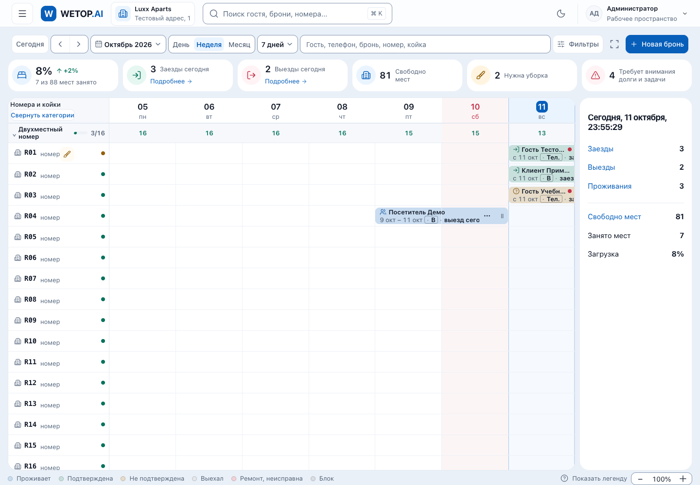
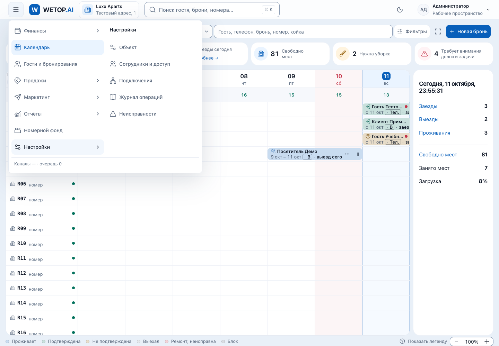
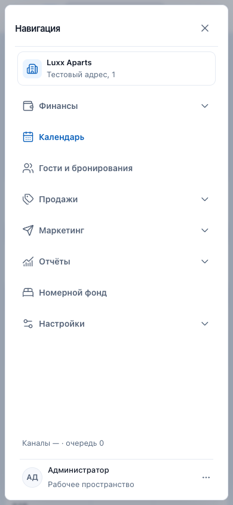

# Фактический аудит UI3.1

11.10.2026. Проверяемый коммит e523f35fdc7d8d333d957e40571fd9a1417cf512, родитель b811e67f8ab0e77b39b4f3aa4e2e7945fd70ffdd. Runtime в ходе аудита не редактировался. Статус: общая оболочка реализована, полная приёмка пока не пройдена. Pixel-perfect редизайн календарей этим коммитом не выполнен.

## 1. Фактический diff

[Полный patch всех файлов, включая бинарные изображения](e523f35-full.patch), [читаемый diff кода/тестов/корневых документов](e523f35-code-docs.diff), [полный список 118 файлов с количеством строк](files.md).

Состав: 5 runtime-файлов, 6 файлов тестового кода, 2 нормативных документа, 55 файлов отчётов/снимков, 50 записей и логов тестов. Число 118 не означает 118 изменённых модулей продукта.

| Runtime-файл | Фактическое изменение |
|---|---|
| apps/web/src/components/top-nav.tsx | Меню перед логотипом, удалены BottomNavLinks/нижняя nav, закрытие по route/history/breakpoint, mobile trapFocus, перенос фокуса в готовый main; providers и поиск переиспользованы |
| apps/web/src/components/shell/side-nav.tsx | Один icon trigger, скрытая desktop-панель, hover/focus групп, клавиатура, внешний click, Escape, route/scope dismiss; existing registry/RBAC |
| apps/web/src/components/shell/side-nav.css | Удалены fixed sidebar/232 px reserve и скрытие логотипа; добавлены header/menu geometry, surface tokens и mobile overrides |
| apps/web/src/components/shell/sidebar.tsx | Активная группа определяется через menuSectionsFor текущей вертикали/доступа, а не гостиничный список |
| apps/web/src/app/workspace.css | Mobile header 60 → 56+safe-area; нижний резерв страницы 90 → 24+safe-area |

Новые тесты: tests/ui/ui31-shell.spec.ts (8 сценариев) и tests/branches-ui/ui31-shell.spec.ts (3 вертикали). Адаптированы navigation, side-nav, workspace и profile-menu-readiness. У профиля ожидание промежуточного /today заменено конечным /finance. В workspace есть также небольшое форматирование импорта/одного assertion. API, домен, схема, registry, Icon, зависимости и код специализированных календарей не менялись.

## 2. Нормативные документы

| Файл | Изменение в e523f35 | Что это означает |
|---|---|---|
| DESIGN.md | Да, +6 строк, финальный блок UI3.1 (1286–1290) | Закреплены hidden nav, header 56+safe-area, desktop 560, mobile до 400, target 44, Icon 20, radius 10 и основные события закрытия |
| DECISIONS.md | Да, +11 строк, ADR-UI31 | Зафиксированы решение владельца, scope и сохранение server scope/registry |
| CLAUDE.md | Нет, blob идентичен родителю | Уже требует читать DESIGN.md, но нет явного обновления маршрута чтения/контракта UI3.1 |
| AGENTS.md | Нет | Общие правила безопасности остаются, визуальные числа здесь не добавлялись |
| apps/web/CLAUDE.md, apps/web/AGENTS.md | Нет | Первый содержит @AGENTS.md, второй сгенерированные Next-инструкции; отдельной ссылки на текущий UI3.1 нет |
| design/tokens.json, apps/web/src/app/tokens.css, apps/site/src/app/tokens.css | Нет | Новая палитра/шрифт не вводились; global --header-h остаётся 100 px, effective workspace override даёт 56+safe-area |

Недостаточно просто сказать «правила не закреплены»: часть уже нормативна через DESIGN.md. Но внедрение документации неполное и противоречивое:

- DESIGN.md §4, строки 107–110, всё ещё предписывает две строки 56+44, mobile 60 и bottom navigation. Строка 125 требует резерв под неё.
- §8, строка 316: старая панель 220+280 и trial/freshness в шапке против новых 560 и статусов внутри меню.
- §5: общие radius меню 8/modal 20 не согласованы с исключением UI3.1 radius 10.
- Подробные padding/gap/mobile/focus/breakpoint и контракт неизменяемых полей/кнопок/таблиц находятся преимущественно в report-spec; не встроены в соответствующие нормативные разделы.
- Три специализированных календаря описаны дополнением в reports, их общий shell-контракт не сведён в DESIGN.md.
- Старый preflight в отчёте UI3.1 неверно говорит, что база уже убрала постоянный резерв слева. Реальный parent diff содержит --sidenav-w:232px, padding-left и position:fixed; их удаляет именно e523f35. Это ошибка отчёта, не повод менять исходный commit задним числом.

Отдельный [план закрепления](normative-plan.md) обновляет существующие DESIGN.md и инструкции Claude, без параллельной системы. В данном аудите эти файлы не менялись.

## 3. Реальные снимки

Сняты в текущем аудите на runtime e523f35, Chrome/Playwright, синтетическая fixture API, а не production.

- [Desktop, меню закрыто](desktop-closed.png), 1440×1000.
- [Desktop, раскрыты Настройки и подразделы](desktop-submenus.png), 1440×1000.
- [Mobile, меню открыто](mobile-open.png), 390×844.

## 4. Сравнение с референсами

[Hospitality reference](reference-hospitality.png), [три вертикали](reference-three-verticals.png). Текстовое решение о скрытом меню имеет приоритет над постоянной панелью на исходных изображениях.

| Область | Фактическое отличие | Оценка |
|---|---|---|
| Навигация | Нет постоянной левой полосы; вместо неё trigger и плавающие две колонки | Утверждённое уточнение, не дефект |
| Шапка | Компактные 56 px; квадратная кнопка с radius 10 вместо круглой; более тёмный синий знак; поля с более заметной границей; нет декоративного колокольчика | Существующие токены/44 px и запрет несуществующих действий важнее точного копирования картинки |
| Общий фон | Выраженный голубовато-серый фон, белые крупно скруглённые карточки, более контрастные поля | Полное визуальное совпадение с почти белым референсом не достигнуто; палитра не менялась |
| Шахматка | Нет заголовка/подзаголовка композиции референса; остаются старые Month/Day/Week/7-days controls; нет единого диапазонного popover | Следующий этап, не реализован в UI3.1 |
| KPI | Шесть компактных плиток вместо пяти более просторных; иные подписи и значения | Сохранены реальные расчёты; данные 68/12/8 из макета не переносились |
| Площадь сетки | Справа остаётся панель дня; она уменьшает сетку, отсутствует в референсе | Не унифицировано этим коммитом |
| Строки и брони | Иные размеры/плотность, формат номеров и карточек, обрезка длинных подписей; стили статусов и легенды прежние | Новый дизайн шахматки не выполнен, поведение бронирований не переписано |
| Mobile | Отдельное почти полноэкранное окно, одна колонка, много свободного пространства перед footer | Отдельная адаптивная поверхность есть; точного mobile-референса не было, компактность требует отдельного визуального решения |
| Beauty | Общая шапка/меню меняются; расписание мастеров уже существовало, STEP=30 | Выбор 15/30 и весь визуальный контракт референса этим commit не добавлены |
| Food | Уже есть CRUD залов/столов и статусы, grid столов сортируется по sortOrder | Свободного редактора геометрической расстановки с координатами/стенами этот commit не добавляет; нельзя говорить, что создание столов вообще отсутствует |

На старом real-API снимке Hospitality видна строка «Нет связи с API». Набор branches-ui поднимает специализированные модули, а /api/freshness проксирует /system/freshness. Эта фотография не доказывает здоровье всех API. FreshnessProvider не менялся; новый fixture-снимок показывает «Каналы · очередь 0». Отдельная полная проверка freshness остаётся нужна при интеграции.

## 5. Проверка поведения

Свежий неизменённый набор: 2026-10-11T18-48-57Z-e2e-777c, **10/12 passed**. Прошли поиск Ctrl+K (локальный, затем общий), меню роли STAFF, light/dark, 7 из 8 UI3.1-сценариев: геометрия, клавиатура, mobile/focus trap, диапазон ширин 320–1536, размеры целей, history на двух ширинах, mobile navigation focus.

Упали: /hotel-settings (15 s до URL) и существующий тест филиала (before boundingBox вернул null до выбора).

Диагностический набор 2026-10-11T18-54-48Z-e2e-1909, 2/2, не подменяет этот красный acceptance: наблюдение перехода и копия branch-сценария с ожиданием visible main. Выбор филиала, cookie, сохранение раздела/reload, Escape/focus, mobile switcher прошли.

Ручные клики по переключателю темы и кнопке поиска desktop/mobile: 2026-10-11T18-59-45Z-e2e-a655, **1/1 passed**. Header остаётся 56 px, тема реально меняет data-theme, окно поиска открывается и закрывается Escape.

Сохранённые проверки исходной реализации: lint/typecheck прошли; real API shell трёх вертикалей и cross-vertical branch switch 4/4 в 2026-10-11T18-09-37Z-e2e-3f7c. Эти результаты повторно прочитаны, не выдаются за новый запуск. Полная матрица ролей/API security, Safari, физические устройства/safe-area и production build в текущем аудите не выполнялись. Registry и серверные guards не изменены; свежий UI role test проверяет STAFF-меню, а не доказывает весь RBAC.

## 6. /hotel-settings и unit

### Переход

Свежий исходный 15-секундный assertion снова красный. Это блокер полной приёмки UI3.1. Нельзя списать его на базовую ветку только потому, что файл hotel-settings не менялся: изменён сам путь взаимодействия с меню.

Диагностика без изменения runtime: click закрывает меню; две завершённые попытки дали HTTP 200, URL и фокус main за 5975 и 1142 ms (ответы через 5371 и 998 ms). См. [данные](ui31-navigation-timing.json). Это подтверждает работоспособность успешного пути и вариативность загрузки, но не устраняет таймаут. В исходном trace запрос не закончен до завершения теста. Next также сообщал Slow filesystem, в новом прогоне benchmark 1429 ms. Гипотеза о cold/dev rendering правдоподобна, точная причинность не доказана.

Для честного A/B предпринят запуск на чистой базе b811e67. Он не дошёл до браузера: Turbopack отверг symlink node_modules за filesystem root. [Лог](baseline/2026-10-11T18-56-43Z-e2e-801a.log). Это отдельная проблема диагностической среды; её нельзя считать ни воспроизведением UI-дефекта на base, ни зелёной base-проверкой. Не выполнялась установка/подмена сборщика ради красивого результата. Следующий шаг: две полноценные изолированные среды с собственными зависимостями, одинаковый build/runtime и cache-state, request/server timings; затем исходный test без повышения порога.

### Три unit-сбоя

Повтор на точном e523f35: 2026-10-11T18-58-02Z-unit-ca06, 3/3 выбранных сценария упали (29 других не выбраны фильтром). Все три ранее воспроизведены на чистой базе b811e67; affected scripts/tests/journal code не изменены в e523f35.

| Сбой | Причина и доказательство | Классификация / действие |
|---|---|---|
| repo-sync.test.ts:545 | scripts/ops/repo-sync.sh:283, $top_rel перед »; системный Bash 3.2.57 + UTF-8 включает байт закрывающего символа в имя переменной | Базовая совместимость ops-script. Минимальный пример падает без UI; ${top_rel} работает. Исправлять отдельным RED/GREEN изменением |
| shift-check-wrapper.test.ts:100 | scripts/ops/shift-check.sh:61, аналогично $day перед » | Тот же базовый дефект; ${day} работает. Смена локали C тоже снимает симптом, но это не предлагается как замена исправлению |
| test-journal-merge.test.ts:94 | Тест читает весь архив 16,58 MB/7996 строк/7904 уникальных записей, пишет/читает тысячи файлов; исходный лимит 5000 ms, свежий тест 6967 ms | Базовый тест/рост истории и стоимость I/O, не UI. Диагностическое равенство данных и вердиктов подтвердилось, но gate остаётся красным |

[Bash минимальные воспроизведения](bash-minimal-repro.json). [Профиль журнала](journal-profile.json): parse 134 ms, write 1470 ms, read/merge/parse 5448 ms, всего 7314 ms, recordsEqual/verdictsEqual true. Это измерение с Node deep comparison, не замена Vitest. Порог теста не менялся, assertions не удалялись. Исправление: отдельно пересмотреть детерминированные unit-fixtures и полную проверку растущего архива/IO, сохранив полноту сравнения; не увеличивать timeout вслепую.

## 7. Матрица состояния

| Область | Реализовано | Проверено | Не реализовано | Требует исправления |
|---|---|---|---|---|
| Desktop menu | Trigger, две колонки, hover/focus, keyboard, close | Свежий UI и снимки | Полная новая композиция календарей | /hotel-settings acceptance |
| Mobile | Overlay, trapFocus, targets 44, bottom-nav удалён | Геометрия 320–960, Escape/focus, screenshot | Реальный iOS/safe-area | Аудит избыточных отступов помощника |
| Header | 56+safe-area, token overrides, theme/search/profile | 56 px, desktop/mobile, ручные клики | Уведомления как в картинке не добавлены | Не добавлять фиктивную кнопку ради референса |
| Branch | Существующий server scope сохранён | Диагностический полный сценарий, исторический real API | Новая модель филиала не нужна | Стандартный тест должен ждать готовый main; до этого нельзя объявлять весь набор зелёным |
| RBAC | Existing registry/guards | Свежий STAFF UI, прежний unit; diff без изменений guards | Полная новая security revalidation | Перед переносом полная матрица ролей на итоговом SHA |
| Normative docs | DESIGN append + ADR | Diff/blobs прочитаны | Согласование §4/§5/§8, Claude links | Противоречия и неточный preflight |
| Tokens | Используются существующие | Blobs неизменны, computed header/targets | Новая палитра/шрифт не вводились | Не менять global header-h без карты потребителей |
| Hospitality | Существующая рабочая сетка | Shell/search/mobile; не полный новый booking audit | Единый period popover, визуальная шахматка референса | Следующий согласованный этап |
| Beauty | Существующая сетка мастеров, shell | Исторические real API screenshots | UI3-срез 15/30 и дальнейшее оформление | Отдельный scope |
| Food | Существующие CRUD залов/столов и статусы, shell | Исторические real API screenshots | Геометрический редактор расстановки | Отдельный scope и model review при новых полях |
| Общий gate | Реализация сохранена локально | Unit причины классифицированы | Полностью зелёная приёмка | 3 базовых unit + нестабильный переход + test race филиала |

## 8. Перенос

[Безопасный план переноса](transfer-plan.md). Read-only проверка remote main показала 69958ac9625e6021694647892eb88aaca4ca014a; база UI3.1 другая. Бесконфликтность с новым main не проверена. Чужой dirty checkout не менялся. Никаких transfer/cherry-pick/merge/push/deploy; нормативные файлы сейчас также не переписывались. Отчёт и диагностические материалы оставлены отдельно для review.
